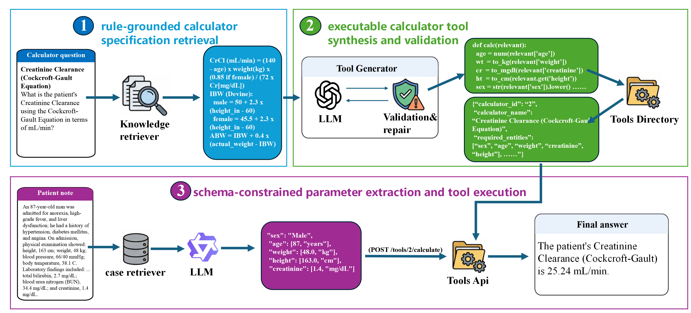
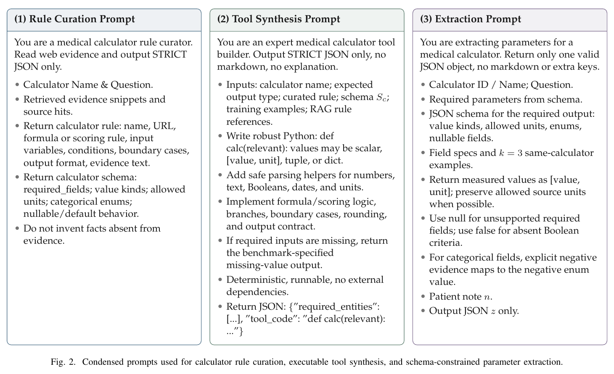

# Tool-Augmented Large Language Models for Reliable Medical Calculation from Patient Notes

[中文说明](README_zh.md)

Yang Zhong, Ling Luo, Xuanlyu Zhu, Yanhua Wang, Yuanyuan Sun, Jian Wang, Hongfei Lin.

This public research artifact follows the final supplied LaTeX source. The manuscript is not edited by this repository update. No acceptance, DOI, or arXiv publication is implied.

The manuscript reports **86.73% final-answer accuracy** on MedCalc-Bench
Verified v1.0.7. This repository provides code and reproduction instructions,
not archived per-case predictions or complete LLM responses. Evaluation
limitations are documented in [known issues](results/KNOWN_ISSUES.md).

This repository implements a tool-augmented LLM framework that separates clinical-language understanding from deterministic medical calculation. The system retrieves calculator specifications, synthesizes and validates reusable Python tools, extracts schema-constrained parameters from patient notes, and executes the frozen tools to produce auditable calculations.



Figure 1 from the final manuscript's `figures/image1.png`, illustrated with the Cockcroft-Gault
creatinine-clearance calculator. This is the original source image; its
provenance and checksum are recorded in [assets/figure1.source.json](assets/figure1.source.json).



Figure 2 from the final LaTeX source summarizes the prompt contracts. The
three main stages share the templates in
[src/toolmed_agent/prompts.py](src/toolmed_agent/prompts.py); actual requests
fill in the rule evidence, schema, examples, and current note. See
[the prompt-to-code mapping](docs/PROMPTS.md) for details.

## Highlights

- Rule-grounded synthesis and execution-based repair of medical-calculator tools.
- Calculator-specific JSON schemas and three same-calculator demonstrations for parameter extraction.
- A frozen set of 55 calculator tools used by the submitted manuscript.
- Aggregate results, portable configuration templates, data preparation, and CPU-only validation scripts.
- No API keys, model weights, manuscripts, raw LLM traces, or full benchmark files are committed.

Reproducing the end-to-end result additionally requires the submitted SFT
adapter, which is not distributed here. The released calculators can be
tested independently with gold input parameters. See
[docs/REPRODUCTION.md](docs/REPRODUCTION.md) for requirements and commands.

## Repository layout

```text
.
├── artifacts/
│   ├── calculators/gpt_5_5/   # 55 frozen tools; 53 passed all training checks
│   └── memory/                # public rule stubs; mutable memory is ignored
├── assets/                    # manuscript-created figures
├── configs/                   # secret-free configuration templates
├── data/processed/            # note-free, licensed few-shot metadata
├── docs/                      # reproducibility notes
├── examples/                  # CPU-only calculator input and expected output
├── results/                   # small reported aggregates and evaluation notes
├── scripts/                   # download, run, and repository validation
├── src/toolmed_agent/         # installable Python package
└── tests/                     # CPU-only regression tests
```

## Installation

The experiment code targets Linux, Python 3.10, CUDA, and NVIDIA GPUs. Repository validation and calculator execution are CPU-compatible.

```bash
python -m venv .venv
source .venv/bin/activate
python -m pip install --upgrade pip
python -m pip install -r requirements.txt
python -m pip install -e .
```

For local LLM inference and embedding-based retrieval:

```bash
python -m pip install -r requirements-local.txt
```

`vLLM` and the original shell launchers require a supported Linux/CUDA environment.

## Data preparation

Benchmark files are not duplicated in this repository. Download the pinned upstream release:

```bash
python scripts/download_data.py
```

The downloader verifies SHA-256 checksums for MedCalc-Bench Verified v1.0.7 and
reconstructs the ignored few-shot case library from a committed note-free
template. The included processed metadata are adaptations of that dataset and
remain subject to CC BY-SA 4.0. See [data/README.md](data/README.md) and
[NOTICE.md](NOTICE.md).

## Configuration

Copy the template and add credentials or local model paths only in your untracked file:

```bash
cp configs/runtime.env.example runtime.env
```

Never commit `runtime.env`. The default template reuses the released calculator tools, disables unit normalization, and writes case-level outputs only to ignored directories.

## Run

Validate the repository without a GPU or API:

```bash
python scripts/validate_artifacts.py
python -m unittest discover -s tests -v
```

Try one released calculator without a model, API key, or benchmark download:

```bash
python scripts/run_calculator.py --input examples/mean_arterial_pressure/input.json
```

The sample uses systolic/diastolic pressures of 120/80 mmHg and returns
93.33333333333333 mmHg. Its input, expected output, and scope are documented in
[examples/README.md](examples/README.md).

After downloading the benchmark, reproduce the submitted 94.91% fixed-tool
score using ground-truth input entities:

```bash
python scripts/evaluate_calculators.py
```

Run a one-case pipeline smoke test after configuring reachable central and
extraction models:

```bash
LIMIT=1 bash scripts/run_pipeline.sh
```

Equivalent direct invocation:

```bash
toolmed-run --root-dir . --env-file runtime.env --limit 1
```

Tool generation and full experimental reproduction require the model endpoints or local checkpoints described in [docs/REPRODUCTION.md](docs/REPRODUCTION.md).

To audit an existing complete raw prediction archive without rerunning an LLM:

```bash
python scripts/rescore_extractions.py --predictions output/private_run.steps.jsonl --output output/parameter_audit.json
```

The command requires all 1,100 raw extraction objects and the pinned test CSV.
Stored match counts alone are insufficient. It preserves archived final
judgments and produces corrected parameter/category/error-group aggregates.

## Citation

The seven-author order follows the final `main.tex`, not the older six-author
PDF bundled alongside it. See [CITATION.cff](CITATION.cff).

```bibtex
@unpublished{zhong2026toolaugmented,
  title = {Tool-Augmented Large Language Models for Reliable Medical Calculation from Patient Notes},
  author = {Zhong, Yang and Luo, Ling and Zhu, Xuanlyu and Wang, Yanhua and Sun, Yuanyuan and Wang, Jian and Lin, Hongfei},
  year = {2026},
  note = {Manuscript; associated research code},
  url = {https://github.com/benjiesun/tool-augmented-medical-calculation}
}
```

## License and intended use

Most source code is released under the [Apache License 2.0](LICENSE).
`src/toolmed_agent/evaluation.py` and dataset-derived files remain under
CC BY-SA 4.0 as described in [NOTICE.md](NOTICE.md).

This software is a research artifact, not a medical device. It has not been validated for clinical deployment and must not be used to diagnose, treat, or make patient-care decisions. Generated Python tools execute code and should be reviewed and sandboxed before use.
