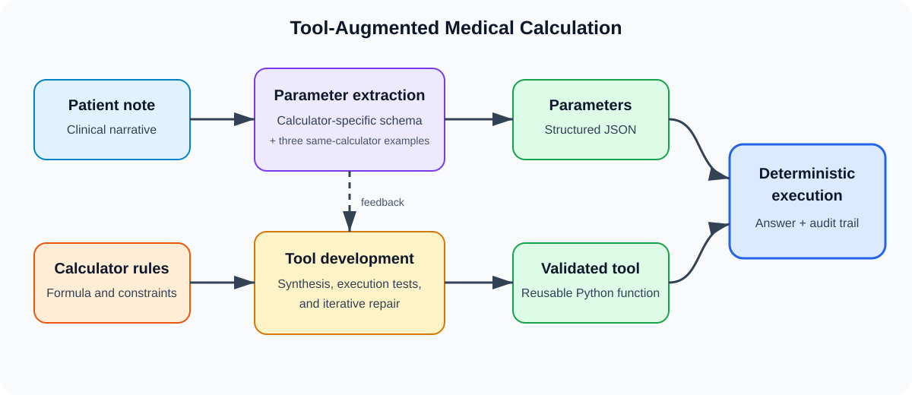

# Tool-Augmented Large Language Models for Reliable Medical Calculation from Patient Notes

[中文说明](README_zh.md)

> **Double-blind review notice:** this artifact is being prepared during an active double-blind review period. Keep the repository private and do not mirror it from a personally identifying account before the review decision. Author and archival citation information will be added after the review period.

This repository implements a tool-augmented LLM framework that separates clinical-language understanding from deterministic medical calculation. The system retrieves calculator specifications, synthesizes and validates reusable Python tools, extracts schema-constrained parameters from patient notes, and executes the frozen tools to produce auditable calculations.



## Highlights

- Rule-grounded synthesis and execution-based repair of medical-calculator tools.
- Calculator-specific JSON schemas and three same-calculator demonstrations for parameter extraction.
- A validated set of 55 calculator tools used by the submitted manuscript.
- Aggregate results, portable configuration templates, data preparation, and CPU-only validation scripts.
- No API keys, model weights, manuscripts, raw LLM traces, or full benchmark files are committed.

## Submitted results

The submitted manuscript evaluates on MedCalc-Bench Verified v1.0.7 (55 calculators, 1,100 test cases).

| Method | Final accuracy |
|---|---:|
| Qwen3-8B one-shot prompting | 62.73% |
| Qwen3-8B SFT-only | 69.46% |
| Tool-augmented framework, Qwen3-8B-SFT extractor | **86.73%** |

The submitted run contains 954/1,100 correct final calculations and a parameter matching rate of 5,241/5,377 (97.47%). The GPT-5.5 retrieval-and-repair tool set achieves 94.91% tool-level accuracy with zero runtime errors in the reported evaluation.

The repository retains the submitted project's answer adapter and scoring protocol. The post-submission calculator-69 parsing change has been withdrawn, and the submitted results remain unchanged. The project's answer adapter is distinct from the upstream benchmark's scoring function; see [Evaluation protocol](results/KNOWN_ISSUES.md).

Detailed aggregate tables are in [results/README.md](results/README.md).

## Repository layout

```text
.
├── artifacts/
│   ├── calculators/gpt_5_5/   # 55 validated calculator tools
│   └── memory/                # public rule stubs; mutable memory is ignored
├── assets/                    # manuscript-created figures
├── configs/                   # secret-free configuration templates
├── data/processed/            # note-free, licensed few-shot metadata
├── docs/                      # reproducibility notes
├── results/                   # aggregate tables only
├── scripts/                   # download, run, and repository validation
├── src/toolmed_agent/         # installable Python package
└── tests/                     # CPU-only regression tests
```

## Installation

The experiment code targets Linux, Python 3.10, CUDA, and NVIDIA GPUs. Repository validation and calculator execution are CPU-compatible.

```bash
python -m venv .venv
source .venv/bin/activate
python -m pip install --upgrade pip
python -m pip install -r requirements.txt
python -m pip install -e .
```

For local LLM inference and embedding-based retrieval:

```bash
python -m pip install -r requirements-local.txt
```

`vLLM` and the original shell launchers require a supported Linux/CUDA environment.

## Data preparation

Benchmark files are not duplicated in this repository. Download the pinned upstream release:

```bash
python scripts/download_data.py
```

The downloader verifies SHA-256 checksums for MedCalc-Bench Verified v1.0.7 and
reconstructs the ignored few-shot case library from a committed note-free
template. The included processed metadata are adaptations of that dataset and
remain subject to CC BY-SA 4.0. See [data/README.md](data/README.md) and
[NOTICE.md](NOTICE.md).

## Configuration

Copy the template and add credentials or local model paths only in your untracked file:

```bash
cp configs/runtime.env.example runtime.env
```

Never commit `runtime.env`. The default template reuses the released calculator tools, disables unit normalization, and writes case-level outputs only to ignored directories.

## Run

Validate the repository without a GPU or API:

```bash
python scripts/validate_artifacts.py
python -m unittest discover -s tests -v
```

After downloading the benchmark, reproduce the submitted 94.91% fixed-tool
score using ground-truth input entities:

```bash
python scripts/evaluate_calculators.py
```

Run a one-case pipeline smoke test after configuring reachable central and
extraction models:

```bash
LIMIT=1 bash scripts/run_pipeline.sh
```

Equivalent direct invocation:

```bash
toolmed-run --root-dir . --env-file runtime.env --limit 1
```

Tool generation and full experimental reproduction require the model endpoints or local checkpoints described in [docs/REPRODUCTION.md](docs/REPRODUCTION.md).

## Citation

Citation metadata is intentionally withheld during double-blind review. After the review period, this section will be replaced with the final bibliographic record and `CITATION.cff`.

## License and intended use

Most source code is released under the [Apache License 2.0](LICENSE).
`src/toolmed_agent/evaluation.py` and dataset-derived files remain under
CC BY-SA 4.0 as described in [NOTICE.md](NOTICE.md).

This software is a research artifact, not a medical device. It has not been validated for clinical deployment and must not be used to diagnose, treat, or make patient-care decisions. Generated Python tools execute code and should be reviewed and sandboxed before use.
