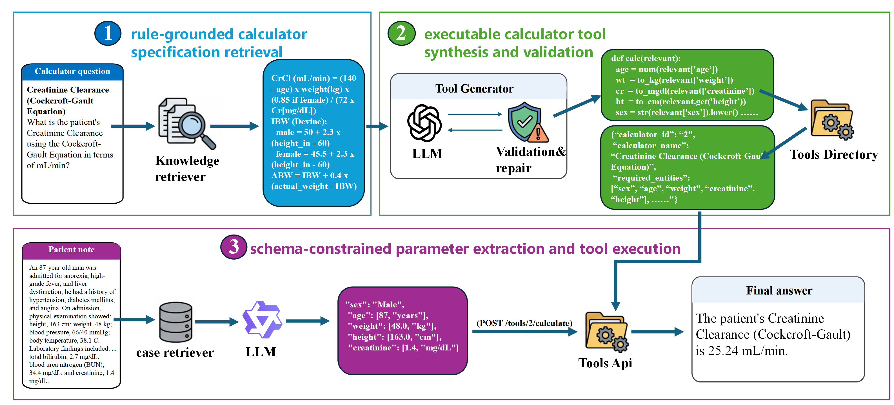

# 面向患者记录可靠医学计算的工具增强大语言模型

[English](../README.md) | [中文](README_zh.md)

Yang Zhong、Ling Luo、Xuanlyu Zhu、Yanhua Wang、Yuanyuan Sun、Jian Wang、Hongfei Lin

论文 *Tool-Augmented Large Language Models for Reliable Medical Calculation from Patient Notes* 的代码实现。

本方法将基于 schema 的参数抽取与可复用 Python 计算器结合：检索并结构化医学计算规则，通过执行反馈生成和验证工具，从患者记录中抽取参数，再调用工具完成计算。论文在 MedCalc-Bench Verified v1.0.7 上的最终答案准确率为 **86.73%**。

## 方法概览



流程包括规则检索与整理、计算器生成与验证、参数抽取和确定性工具执行。仓库提供 55 个计算器工具、计算器专属 schema，以及每个抽取任务的 3 个同类示例。


三组提示词统一实现在 [prompts.py](../src/toolmed_agent/prompts.py)。输入内容及调用入口见[提示词说明](PROMPTS.md)。

## 安装

使用 Python 3.10 或更高版本。本地大模型推理需要 Linux、CUDA 和 NVIDIA GPU；计算器执行及仓库测试也可在 CPU 上运行。

```bash
git clone https://github.com/benjiesun/tool-augmented-medical-calculation.git
cd tool-augmented-medical-calculation
python -m venv .venv
source .venv/bin/activate
python -m pip install -r requirements.txt
python -m pip install -e .
```

Windows PowerShell 中使用 `.\.venv\Scripts\Activate.ps1` 激活环境。

本地模型推理及向量检索还需安装：

```bash
python -m pip install -e ".[local,retrieval]"
```

## 数据与模型准备

下载基准数据并准备示例库：

```bash
python src/download_data.py
```

脚本下载 MedCalc-Bench Verified v1.0.7，校验文件哈希，并为每个计算器准备 3 个训练示例。生成文件见[数据说明](../data/README.md)。

复制配置模板，在 `runtime.env` 中填写模型路径和 API 地址：

```bash
cp data/runtime.env.example runtime.env
```

采用论文的抽取配置时，将 `EXTRACTION_MODEL_PATH` 指向 Qwen3-8B，将 `EXTRACTION_SFT_LORA_PATH` 指向抽取任务的 LoRA adapter。**当前版本未提供训练后的 adapter。** 计算器可以独立于抽取模型运行。模型依赖与训练设置见[复现指南](REPRODUCTION.md)。

## 使用方法

### 运行单个计算器

```bash
python src/run_calculator.py --input data/examples/mean_arterial_pressure/input.json
```

示例输入收缩压 120 mmHg、舒张压 80 mmHg，返回平均动脉压约 93.33 mmHg。输入输出格式见[示例说明](../data/examples/README.md)。

### 运行参数抽取与计算流程

配置 central 和 extraction 模型后运行：

```bash
toolmed-run --root-dir . --env-file runtime.env --limit 1
```

使用 `--limit 0` 处理完整测试集。输出保存到 `output/`、`result/` 和 `judge/`。

### 评估计算器

```bash
python src/evaluate_calculators.py
```

该命令使用标准输入参数评估计算器执行；端到端评估还包括参数抽取。指标定义与答案处理方式见[评测说明](EVALUATION.md)。

### 运行测试

```bash
python src/validate_artifacts.py
python -m unittest discover -s tests -v
```

这些检查无需 GPU 或模型 API。工具生成与消融实验的运行方式见[复现指南](REPRODUCTION.md#tool-generation)。

## 仓库结构

| 目录 | 内容 |
|---|---|
| `src/` | 数据准备与运行脚本，核心代码位于 `toolmed_agent/` |
| `artifacts/` | 55 个计算器、校验清单及规则元数据 |
| `data/` | Schema、示例元数据、配置模板和输入输出示例 |
| `docs/` | 论文图片、中文 README、复现指南和技术说明 |
| `tests/` | CPU 回归测试 |
| `.github/` | Windows/Linux 自动检查 |

## 引用

如果本项目对你的研究有帮助，请引用：

```bibtex
@unpublished{zhong2026toolaugmented,
  title = {Tool-Augmented Large Language Models for Reliable Medical Calculation from Patient Notes},
  author = {Zhong, Yang and Luo, Ling and Zhu, Xuanlyu and Wang, Yanhua and Sun, Yuanyuan and Wang, Jian and Lin, Hongfei},
  year = {2026},
  note = {Manuscript},
  url = {https://github.com/benjiesun/tool-augmented-medical-calculation}
}
```

## 许可

项目代码采用 [Apache License 2.0](../LICENSE)；基准衍生的评测代码和数据文件采用 CC BY-SA 4.0。第三方归属与许可详情见 [许可说明](NOTICE.md)。

本项目仅供科研使用，尚未经过临床验证。生成代码应经审查后在隔离环境中执行，详见 [代码执行说明](NOTICE.md#safe-execution)。
